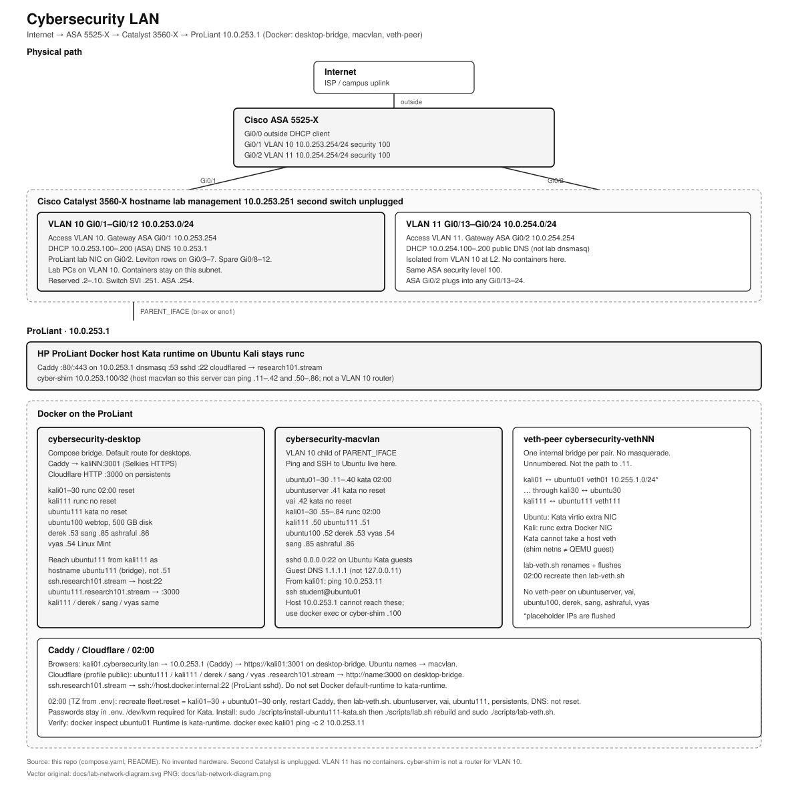
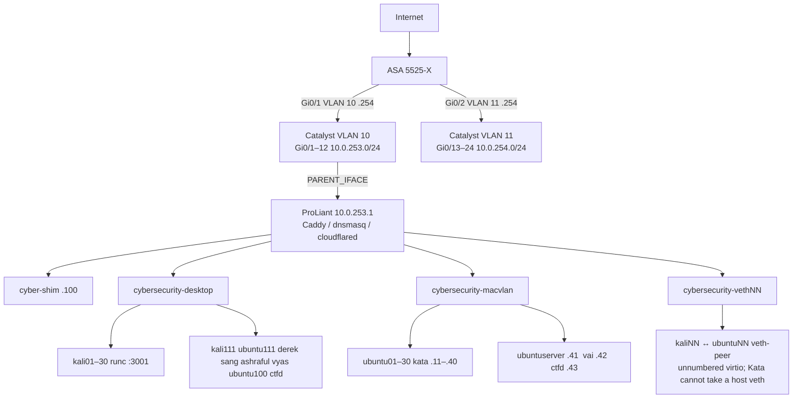

# Cybersecurity LAN

Operator guide for the ProLiant lab: thirty Kali desktops in the browser, thirty Ubuntu SSH servers, plus a few persistent boxes. Names sit under `cybersecurity.lan`. Anyone who can open a Kali URL gets a desktop with passwordless sudo inside that container. Keep this on a trusted LAN.

**Ubuntu is Kata. Kali is runc.** ubuntu01–30, ubuntuserver, vai, ubuntu111, and ctfd use Compose `runtime: kata-runtime`. Do not set Docker’s `default-runtime` to kata. Passwords live in `.env` only. Never commit `.env`.

## What this lab is

A Cisco ASA 5525-X sits in front of an HPE ProLiant. One Catalyst 3560-X (hostname `lab`) carries VLANs. Docker Compose on the ProLiant runs the fleet.

| Piece | Role |
| --- | --- |
| ASA `Gi0/0` | Outside, DHCP |
| ASA `Gi0/1` (`inside`) | VLAN 10, `10.0.253.254/24`, security 100. DHCP `10.0.253.100`–`.200`, DNS `10.0.253.1` |
| ASA `Gi0/2` | VLAN 11, `10.0.254.254/24`. Lab PCs only. No containers here |
| Switch `Gi0/1`–`Gi0/12` | Access VLAN 10 (`LAB`), `spanning-tree portfast` |
| Switch `Gi0/13`–`Gi0/24` | Access VLAN 11 |
| Switch `Vlan10` | `10.0.253.251/24`, gateway `10.0.253.254`. Routing off |
| ProLiant | `10.0.253.1` on `PARENT_IFACE` (`br-ex` or `eno1`). Docker host, Caddy, dnsmasq, Kata |

| From | To | VLAN |
| --- | --- | --- |
| Internet cable | ASA `Gi0/0` | outside |
| ASA `Gi0/1` | 3560-X `Gi0/1` | 10 |
| ProLiant lab NIC | 3560-X `Gi0/2` | 10 |
| Leviton rows 1–5 | 3560-X `Gi0/3`–`Gi0/7` | 10 |
| Spare | 3560-X `Gi0/8`–`Gi0/12` | 10 |
| ASA `Gi0/2` | any 3560-X `Gi0/13`–`Gi0/24` | 11 |

Plug only the ProLiant NIC that holds `10.0.253.1`. If that address lives on `br-ex` and `eno1` is a bridge member, the cable is in `eno1` and `PARENT_IFACE` is `br-ex`. `show vlan id 10` should list `Gi0/1`–`Gi0/12`. Console is the rear CONSOLE port.

Containers stay on `10.0.253.0/24` (VLAN 10). The ASA is the upstream gateway at `10.0.253.254`. Compose `LAN_GATEWAY` is this server (`10.0.253.1`).

## Network diagram

Physical path and Docker networks on the ProLiant. Vector: [`docs/lab-network-diagram.svg`](docs/lab-network-diagram.svg). PNG: [`docs/lab-network-diagram.png`](docs/lab-network-diagram.png).





## IP plan

Two Docker networks matter for reachability:

- **`cybersecurity-desktop`** — Compose bridge. Caddy talks to Kali on `:3001`. Cloudflare talks to persistent desktops on `:3000`. Default route for those boxes.
- **`cybersecurity-macvlan`** — VLAN 10, parent `PARENT_IFACE`. Ping and SSH to Ubuntu. Kali fleet has a second address here.

`kali01.cybersecurity.lan` through `kali30.cybersecurity.lan` resolve to `10.0.253.1`. Browsers hit Caddy (80/443). Caddy picks the container from the Host name and proxies `https://kaliNN:3001` on the desktop bridge. Ubuntu names resolve to the macvlan address. Nothing publishes container SSH on the ProLiant’s port 22.

| Name | Macvlan | Desktop bridge | Runtime | 02:00 reset |
| --- | --- | --- | --- | --- |
| ProLiant | `10.0.253.1` | — | host | no |
| ubuntu01–30 | `10.0.253.11`–`.40` | no | kata-runtime | yes |
| ubuntuserver | `10.0.253.41` | no | kata-runtime | no |
| vai | `10.0.253.42` | no | kata-runtime | no |
| ctfd | `10.0.253.43` | yes (`http://ctfd:8000`) | kata-runtime | no |
| kali111 | `10.0.253.50` | yes (`http://kali111:3000`) | runc | no |
| ubuntu111 | `10.0.253.51` | yes (`http://ubuntu111:3000`) | kata-runtime | no |
| ubuntu100 | `10.0.253.52` | yes | runc (webtop) | no |
| derek | `10.0.253.53` | yes (`http://derek:3000`) | runc | no |
| vyas | `10.0.253.54` | yes (`http://vyas:3000`) | runc (Mint) | no |
| kali01–30 | `10.0.253.55`–`.84` | yes (`https://kaliNN:3001`) | runc | yes |
| sang | `10.0.253.85` | yes (`http://sang:3000`) | runc | no |
| ashraful | `10.0.253.86` | yes (`http://ashraful:3000`) | runc | no |
| cyber-shim | `10.0.253.100/32` | — | host macvlan | — |
| Switch SVI | `10.0.253.251` | — | — | — |
| ASA inside | `10.0.253.254` | — | — | — |

Reserved on VLAN 10: `10.0.253.2`–`.10`. Do not assign them.

**How to reach Ubuntu**

- Fleet (ubuntu01–30): ping/SSH the macvlan address (`10.0.253.11` for ubuntu01). From kali01: `ping -c 2 10.0.253.11` then `ssh student@ubuntu01`.
- ubuntu111: from kali111 use hostname `ubuntu111` on the **desktop bridge**, not `10.0.253.51` and not `veth-peer`. `ping -c 2 ubuntu111` then `ssh van@ubuntu111`.
- ctfd: SSH as `CTFD_USER` (default `ctfd`) with `CTFD_PASSWORD` from `.env` — not `DESKTOP_PASSWORD`. From a lab PC: `ssh ctfd@10.0.253.43` or `ssh ctfd@ctfd.cybersecurity.lan`. From Kali: `ssh ctfd@ctfd`. CTFd HTTP is `http://ctfd:8000` on the desktop bridge (Cloudflare), not Caddy. The web admin is the same username and password.

The ProLiant cannot ping a macvlan child on the same NIC (`10.0.253.1` → `10.0.253.11` times out). Lab PCs can. From the host use `docker exec` or `sudo ./scripts/lab-veth.sh` (adds `cyber-shim` at `10.0.253.100` and routes `.11`–`.43` and `.50`–`.86`).

Every Compose service has `mem_limit: 4g` (a ceiling, not a reservation). Desktops also have `shm_size: 1gb`.

## Secrets (`.env`)

```sh
cp .env.example .env
# Edit PARENT_IFACE, SERVER_IP, TZ, SSH_USER, and a key or password.
```

Placeholders in `.env.example` are not secrets. Real passwords and keys go only in `.env`, which is gitignored. Do not commit `.env`.

| Variable | What it is |
| --- | --- |
| `PARENT_IFACE` | Interface that already has `10.0.253.1` (`br-ex` or `eno1`) |
| `LAN_SUBNET` / `LAN_GATEWAY` | `10.0.253.0/24` / `10.0.253.1` |
| `SERVER_IP` | `10.0.253.1`. Kali names and bundled DNS |
| `TZ` | 02:00 reset timezone (`America/New_York`, not an offset) |
| `SSH_USER` | Fleet Ubuntu account. Not `root` |
| `SSH_PUBLIC_KEY` or `SSH_PASSWORD` | At least one. `$` in a password must be `$$` |
| `DESKTOP_USER` / `DESKTOP_PASSWORD` | kali111, ubuntu100, ubuntu111, ubuntuserver, vai. Default user `van`. Not ctfd |
| `CTFD_USER` | ctfd sshd, sudo, and CTFd web admin. Default `ctfd` |
| `CTFD_PASSWORD` | Required for ctfd. Container exits if unset. Put it only in `.env`. `$` must be `$$` |
| `CTFD_SECRET_KEY` | CTFd `SECRET_KEY`. Required for gunicorn on `:8000` |
| `CTFD_ADMIN_EMAIL` | Default `ctfd@cybersecurity.lan` |
| `DEREK_USER` / `DEREK_PASSWORD` | derek. Password required or Compose will not start it |
| `VYAS_USER` / `VYAS_PASSWORD` | vyas (Mint). Password required |
| `SANG_USER` / `SANG_PASSWORD` | sang. Password required |
| `ASHRAFUL_USER` / `ASHRAFUL_PASSWORD` | ashraful. Password required |

Empty Selkies passwords turn off the browser login. Compose refuses to start derek, sang, and ashraful until those passwords are set. Ubuntu fleet containers exit until `SSH_PUBLIC_KEY` or `SSH_PASSWORD` is set. ctfd exits until `CTFD_PASSWORD` is set. That is intentional.

`KALI_COUNT` and `UBUNTU_COUNT` default to 30. The repo already contains that render.

## First start

On the ProLiant, from this repo:

```sh
cp .env.example .env
# Set PARENT_IFACE, SSH_USER, and SSH_PUBLIC_KEY or SSH_PASSWORD.
sudo ./scripts/install-ubuntu111-kata.sh
./scripts/lab.sh dns-on
./scripts/lab.sh on
```

The first Kali pull is about 4.8 GB. Watch `docker compose ps` and `docker compose logs -f caddy`. Install the Caddy CA (below), then open https://cybersecurity.lan.

If a host firewall is on, allow 80/443 to `SERVER_IP`, DNS if you use the bundled resolver, and TCP 22 from workstations to the Ubuntu macvlan range (not to the ProLiant).

## Install Kata on the ProLiant

Need Docker CE (`/usr/bin/docker`, not snap), Docker 26+, `/dev/kvm`, and about 3 GB free for the Kata tarball. Bare-metal ProLiant should pass. Nested virt is only if this Ubuntu is itself a VM.

```sh
systemd-detect-virt
# none = bare metal
ls -l /dev/kvm
grep -E -o '(vmx|svm)' /proc/cpuinfo | sort -u

sudo ./scripts/install-ubuntu111-kata.sh
# same installer: sudo ./scripts/install-ubuntu-kata.sh
```

The script installs Kata 4.4.0 as Docker runtime `kata-runtime`, writes `/etc/kata-containers/runtime-rs/configuration-qemu-runtime-rs.toml` (`internetworking_model = "tcfilter"`, `disable_new_netns = false`), and does **not** change Docker’s default runtime (Kali stays runc). Re-run after `git pull` to patch networking; it skips the download if the shim is already there. It does not `docker rm` the fleet, does not start Ubuntu, and does not restart dnsmasq.

Then recreate Ubuntu and restore pair cables:

```sh
git pull
sudo ./scripts/install-ubuntu111-kata.sh
./scripts/lab.sh rebuild
sudo ./scripts/lab-veth.sh
```

Do **not** set `"default-runtime": "kata-runtime"`. Do **not** run `lab.sh on` / `off` for this. Do **not** `docker compose restart` dnsmasq. Do **not** `docker rm $(docker ps -a -q) -f`. Fallback if reload does not list `kata-runtime`: `systemctl restart docker` (`restart: unless-stopped` brings other containers back, including dnsmasq — still do not compose-restart dnsmasq). `KATA_INTERNETWORKING=macvtap` is the fallback if tcfilter cannot attach macvlan. Do not set `none` or `disable_new_netns = true`.

`rebuild` builds `cybersecurity-ubuntu-ssh:1` and force-recreates ubuntu01–30, ubuntuserver, and vai. It does not recreate Kali, Caddy, or dnsmasq. Each Ubuntu box is a Kata QEMU guest, so the first recreate is **slow, not hung**. Compose `up 46/62` is 30 `cybersecurity-vethNN` networks plus 32 containers; veth01–28 appearing quickly is expected. Starting all 30 VMs at once saturates `/dev/kvm`. `rebuild` now starts Ubuntu in batches of 5 (`KATA_BATCH`). Leave a running `up` alone if QEMU processes are increasing. ubuntu111 is extra-containers; recreate it only if you want that desktop too:

```sh
docker compose build ubuntu111
docker compose up -d --force-recreate --no-deps ubuntu111
sudo ./scripts/lab-veth.sh
```

## Day to day

All of these are run on the ProLiant, from the repo.

| Command | What it does |
| --- | --- |
| `./scripts/lab.sh on` | Start kali01–30 and ubuntu01–30 only, then `lab-veth.sh` |
| `./scripts/lab.sh off` | `docker stop` those 60 IDs only. DNS and extras stay up |
| `./scripts/lab.sh rebuild` | Build Ubuntu image; force-recreate ubuntu01–30 in Kata batches of 5, then ubuntuserver and vai; then `lab-veth.sh` |
| `./scripts/lab.sh extra-containers-on` | Start derek, vyas, kali111, ubuntu111, sang, ashraful, vai, ctfd |
| `./scripts/lab.sh extra-containers-off` | Stop those eight |
| `./scripts/lab.sh dns-on` | Start only dnsmasq |
| `./scripts/lab.sh dns-off` | Stop only dnsmasq |
| `sudo ./scripts/lab-veth.sh` | Restore `veth-peer` on each pair; add `cyber-shim` |
| `./scripts/reset-now.sh` | Run the 02:00 recreate now |

`on` is `docker compose up -d` with those 60 names, not a bare `up -d`, so it does not bounce kali111, Caddy, or dnsmasq. `off` does not call `docker compose stop`. `.env` may set `COMPOSE_PROFILES=dns`; `lab.sh` clears that for `on` / `off` / extras / `rebuild`.

To pull a newer Kali image (the 02:00 job does not pull):

```sh
docker compose pull kali01
./scripts/reset-now.sh
```

All 30 Kali services share `lscr.io/linuxserver/kali-linux:latest`. One copy on disk.

## Verify

```sh
docker inspect ubuntu01 --format '{{.HostConfig.Runtime}}'
# kata-runtime

docker exec ubuntu01 ip -br
# macvlan 10.0.253.11, plus veth-peer UP with no address

docker exec ubuntu01 ss -lntp | grep ':22'
# 0.0.0.0:22

docker exec ubuntu01 command -v ping
docker exec ubuntu01 cat /etc/resolv.conf
# nameserver 1.1.1.1  — not 127.0.0.11

docker exec kali01 ping -c 2 10.0.253.11
docker exec kali01 ip link show veth-peer
docker exec ubuntu01 ip link show veth-peer
```

From a kali01 terminal: `ping -c 2 10.0.253.11` then `ssh student@ubuntu01`.

ubuntu111 (from kali111, desktop-bridge hostname):

```sh
docker inspect ubuntu111 --format '{{.HostConfig.Runtime}}'
docker exec ubuntu111 ip -br
docker exec kali111 ping -c 2 ubuntu111
# then: ssh van@ubuntu111
```

`uname -r` inside an Ubuntu Kata guest should not match the ProLiant.

## 02:00 reset

[`scheduler/crontab`](scheduler/crontab) is `0 2 * * *`. Timezone is `TZ` from `.env` (`America/New_York` means 02:00 in New York). An unknown `TZ` makes the scheduler exit.

[`scheduler/reset-desktops.sh`](scheduler/reset-desktops.sh):

1. Recreate every service labeled `fleet.reset: "true"` — **kali01–30** (runc, one compose up) **and ubuntu01–30** (Kata, batches of 5).
2. Restart Caddy (not recreate; CA volume stays).
3. Run `scripts/lab-veth.sh` so each pair gets `veth-peer` back (Kata virtio extra NIC, not a host veth).

**Not reset at 02:00:** ubuntuserver, vai, ctfd, ubuntu111, ubuntu100, kali111, derek, vyas, sang, ashraful, Caddy, dnsmasq, scheduler, cloudflared.

Kali home is tmpfs (`/config`) — empty after recreate. Ubuntu fleet has no volume — the writable layer goes away (account, host keys, `/sharedfolder`). The entrypoint recreates `SSH_USER` from `.env`. Packages in the image (`apt`, `ping`, `sshd`, `nfs-kernel-server`) come back. Packages you `apt install` later do not. The NFS lab is not started again.

Run it yourself: `./scripts/reset-now.sh`. Logs: `docker compose logs scheduler`. After `git pull` of scheduler changes:

```sh
docker compose build scheduler
docker compose up -d --no-deps scheduler
```

## Ubuntu is Kata; Kali is runc

Compose sets `runtime: kata-runtime` on ubuntu01–30, ubuntuserver, vai, ubuntu111, and ctfd. That is Kata Containers (QEMU, runtime-rs shim) with its own guest kernel. Kali, including kali01–30 and kali111, stays runc. Default Docker runtime stays runc.

A Kata guest does not see Docker DNS at `127.0.0.11` (that address is in the shim, not the VM). `ubuntu/kata-net.sh` (server image) and `ubuntu/cont-init.d/98-kata-net` (ubuntu111) replace it with `1.1.1.1` / `8.8.8.8`. Fleet Ubuntu default route is the macvlan LAN. ubuntu111 prefers the desktop bridge (Docker NAT) so Cloudflare `http://ubuntu111:3000` still works. Do not `dhclient` the virtio NICs.

Fleet Ubuntu image is `cybersecurity-ubuntu-ssh:1` (`ubuntu:24.04` plus OpenSSH, `apt`, `ping`, `ip`, `curl`, `sudo`, nfs packages). sshd listens on `0.0.0.0:22`. It is not a desktop. ubuntu111 is webtop (`cybersecurity-ubuntu111:1`) plus ping and sshd. linuxserver webtop plus Kata is unsupported; the web UI can 502 while SSH still works. `docker compose logs ubuntu111` is the truth.

Sysbox is unused. Leaving `sysbox-ce` installed is harmless while default-runtime is runc.

### Pair cable (`veth-peer`)

kali01’s `veth-peer` is the other end of ubuntu01’s `veth-peer`, through kali30/ubuntu30, and kali111/ubuntu111. No address, no default route, not the path to `10.0.253.11`. ubuntuserver, vai, ctfd, ubuntu100, derek, sang, ashraful, and vyas do not have it.

Kata cannot take a host veth: the Docker pid is the shim netns, not the QEMU guest. Each pair uses Compose network `cybersecurity-vethNN` (internal bridge, no masquerade). Kata hotplugs a virtio NIC. `scripts/rename-veth-peer.sh` names it `veth-peer` and flushes the placeholder `10.255.N.0/24` address. Kali is runc on that same L2; its extra Docker NIC is renamed the same way. `lab-veth.sh` does not `ip link set … netns` into a Kata Ubuntu box. After 02:00 or `rebuild`, run (or the job already ran) `sudo ./scripts/lab-veth.sh`.

NetworkManager on Kali must ignore `veth-peer` (unmanaged, `ipv4.ignore-auto-dns`, no default via that NIC). Kali keeps Docker DNS `127.0.0.11`; a down ubuntu111 must not change that. `192.168.200.1` is not a lab nameserver. `ip` / `dhclient` / `dhcpd` still configure the lab cable.

## Persistent desktops, Caddy, Cloudflare

`lab.sh extra-containers-on` starts derek, vyas, kali111, ubuntu111, sang, ashraful, vai, and ctfd. ubuntu100 is a webtop on a 500 GB disk at `/var/lib/cybersecurity/ubuntu100`; it is not in that list and is not wiped at 02:00. ctfd is not fleet.reset and is not in `lab.sh rebuild`. Flags and the sqlite DB live in `/var/lib/cybersecurity/ubuntu100/ctfd` on that same disk (not a new volume).

derek, sang, ashraful, and kali111 are `linuxserver/kali-linux` (Selkies). Sign-in users come from `.env`. vyas is Linux Mint Cinnamon (`dockerscripts/linuxmint:cinnamon`) with a login page on HTTP 3000, then Firefox and sudo. vyas does not share `DESKTOP_USER`.

Caddy on `10.0.253.1` serves `https://kaliNN.cybersecurity.lan`, plus derek, sang, ashraful, ubuntu100, ubuntu111. Upstream for Kali is `:3001` (Selkies HTTPS). Cloudflare uses HTTP `:3000` on the desktop bridge (`http://ctfd:8000` for CTFd). Do not put another buffering proxy in front.

### CTFd

Kata Ubuntu (`cybersecurity-ctfd:1`), `mem_limit: 4g`, desktop + macvlan `10.0.253.43`. sshd `0.0.0.0:22` as `CTFD_USER` (default `ctfd`) with `CTFD_PASSWORD`. gunicorn `:8000`. Not 02:00, not `rebuild`. Does not use `DESKTOP_USER` / `DESKTOP_PASSWORD`.

```sh
git pull
sudo ./scripts/prepare-ubuntu100-disk.sh
# .env: CTFD_USER=ctfd, CTFD_PASSWORD, CTFD_SECRET_KEY  (do not commit .env)
docker compose build ctfd
docker compose up -d --no-deps --force-recreate ctfd
sudo ./scripts/lab-veth.sh
docker exec ctfd ip -4 addr
# 10.0.253.43 on the macvlan NIC; default route stays on the desktop bridge
ping -c 2 10.0.253.43
```

If ctfd is not running yet, `./scripts/lab.sh extra-containers-on` instead of `--force-recreate`. Do **not** `lab.sh on`/`off`. Do **not** restart dnsmasq. Do **not** `rebuild` for this box. `docker compose build ctfd` is a cache hit except for kata-net (do not rebuild ubuntu01).

**SSH (this agent cannot reach the ProLiant).** From a lab PC: `ssh ctfd@10.0.253.43` or `ssh ctfd@ctfd.cybersecurity.lan`. From Kali: `ssh ctfd@ctfd`. From the internet: `ssh ssh-ctfd.research101.stream` (see tunnel hostname below; not the ProLiant hop). On the ProLiant:

```sh
docker inspect ctfd --format '{{.HostConfig.Runtime}} {{.State.Status}}'
# kata-runtime running
docker exec ctfd ss -ltn
# 0.0.0.0:22 and (after CTFD_SECRET_KEY) 0.0.0.0:8000
docker exec ctfd ls /var/lib/ctfd
```

Existing tunnel hostnames (Cloudflare Zero Trust, service type **HTTP** except SSH):

| Public hostname | Origin |
| --- | --- |
| `derek.research101.stream` | `http://derek:3000` |
| `vyas.research101.stream` | `http://vyas:3000` |
| `ubuntu111.research101.stream` | `http://ubuntu111:3000` |
| `kali111.research101.stream` | `http://kali111:3000` |
| `sang.research101.stream` | `http://sang:3000` |
| `ctfd.research101.stream` | `http://ctfd:8000` |
| `ssh-ctfd.research101.stream` | `ssh://ctfd:22` |
| `ssh.research101.stream` | `ssh://host.docker.internal:22` |

Compose does not create those hostnames. Add them on the **existing** tunnel (Zero Trust → Networks → Tunnels → that tunnel → Public Hostname). Do not install a second `cloudflared`. Do not send public URLs through Caddy. A browser cannot render RDP; replace any leftover RDP routes.

| Hostname | Type | Origin | Notes |
| --- | --- | --- | --- |
| `ctfd.research101.stream` | **HTTP** | `http://ctfd:8000` | CTFd web |
| `ssh-ctfd.research101.stream` | **SSH** | `ssh://ctfd:22` | Direct into the ctfd container. Add an Access application so it is not an open login |
| `ssh.research101.stream` | **SSH** | `ssh://host.docker.internal:22` | ProLiant sshd only (`10.0.253.1:22`). Not ctfd |

`ssh.research101.stream` is the ProLiant’s own sshd. Port 22 is not published by Compose. `ssh-ctfd.research101.stream` is **not** that hop: cloudflared (on `desktop`) connects to container `ctfd:22`.

```sh
git pull
docker compose --profile public up -d --no-deps cloudflared
```

On your laptop (`~/.ssh/config`):

```sshconfig
Host ssh.research101.stream
  User YOUR_PROLIANT_ACCOUNT
  ProxyCommand cloudflared access ssh --hostname %h

Host ssh-ctfd.research101.stream
  User ctfd
  ProxyCommand cloudflared access ssh --hostname %h
```

Then `ssh ssh.research101.stream` (ProLiant) or `ssh ssh-ctfd.research101.stream` (ctfd box). First connection opens a browser for Access.

derek used to be Mint. The named volume `cybersecurity-derek-config` cannot be reused as Kali `/config`. One-time, if that volume is still a Mint home:

```sh
docker compose stop derek
docker compose rm -f derek
docker volume rm cybersecurity-derek-config
docker compose up -d --no-deps derek
```

Do not `dns-off` for that. `https://derek.cybersecurity.lan` needs `docker compose restart caddy` after. Public `derek.research101.stream` does not use dnsmasq.

## SSH to Ubuntu

```sh
ssh student@ubuntu01.cybersecurity.lan
```

Port 22 on the container’s macvlan address. The same `SSH_USER` is created on every fleet Ubuntu at start. ubuntuserver and vai use `DESKTOP_USER` / `DESKTOP_PASSWORD` (default `van`). ctfd uses `CTFD_USER` / `CTFD_PASSWORD` (default user `ctfd`). Root login is off. The account is in `sudo`. Host keys are generated at start (`ssh-keygen -A`); 02:00 wipes fleet keys, so clients must update `known_hosts`. ctfd is not wiped at 02:00.

## DNS

Pick one. You do not need all three.

**Bundled dnsmasq** — `./scripts/lab.sh dns-on` once. Listens on `SERVER_IP:53`. Apex and `kaliNN` → `SERVER_IP`. `ubuntuNN` → that box’s macvlan address. No wildcard (a wildcard would send Ubuntu names to the ProLiant).

```sh
dig @10.0.253.1 kali01.cybersecurity.lan +short
# 10.0.253.1
dig @10.0.253.1 ubuntu01.cybersecurity.lan +short
# 10.0.253.11
```

If port 53 on `SERVER_IP` is taken, set `COMPOSE_PROFILES=` in `.env` and do not run `dns-on`.

**Your own dnsmasq** — leave `COMPOSE_PROFILES` empty. Install [`dns/records.conf`](dns/records.conf) (replace `__SERVER_IP__` / `__BASE_DOMAIN__`). Set `local=/cybersecurity.lan/`. Do not add `address=/cybersecurity.lan/<ip>`.

**Hosts file** — append [`dns/hosts.example`](dns/hosts.example) on each workstation.

## Trust the Caddy CA

Caddy’s CA lives in volume `cybersecurity-caddy-data`. 02:00 does not delete it. Deleting that volume issues a new CA.

```sh
./scripts/export-ca.sh
# writes ./cybersecurity-lan-root.crt
```

- Linux: `sudo cp cybersecurity-lan-root.crt /usr/local/share/ca-certificates/cybersecurity-lan-caddy.crt && sudo update-ca-certificates`
- Firefox: its own Authorities store (or `certutil`)
- macOS: `sudo security add-trusted-cert -d -r trustRoot -k /Library/Keychains/System.keychain cybersecurity-lan-root.crt`
- Windows (Administrator): `certutil -addstore -f "ROOT" cybersecurity-lan-root.crt`

## NFS lab

Student lab on **one** pair. Ubuntu is the server, Kali the client. `lab.sh`, `lab-veth.sh`, and 02:00 do not start NFS. 02:00 drops `/sharedfolder` and `/etc/exports` on fleet Ubuntu, so run it again after reset. Prefer `veth-peer` so NFS stays off the fleet LAN. Same link-local addresses on every pair (the cable is private). Run NFS on one Ubuntu at a time.

```sh
git pull
./scripts/lab.sh rebuild
sudo modprobe nfsd
./scripts/nfs-lab.sh addr          # 192.168.101.1 on ubuntu01 veth-peer, .2 on kali01
./scripts/nfs-lab.sh server
./scripts/nfs-lab.sh client
```

`addr 07` / `server 07` / `client 07` is kali07/ubuntu07. `server 01 macvlan` uses `10.0.253.11` / `10.0.253.55` instead (shares the LAN). Helpers use `docker compose exec --privileged`. Kernel nfsd is loaded on the ProLiant; Kata guests may also `modprobe` their own kernel.

## Change the count

Names stay two digits (`kali01`). Edit `.env`, render, recreate. A smaller count leaves old containers until `--remove-orphans`. 02:00 does not remove orphans.

```sh
# .env
KALI_COUNT=10
UBUNTU_COUNT=10
python3 scripts/render.py
docker compose up -d --build --remove-orphans
```

Re-run [`scripts/render.py`](scripts/render.py) after `KALI_COUNT`, `UBUNTU_COUNT`, `UBUNTU_IP_START`, `BASE_DOMAIN`, `SERVER_IP`, or `SSH_USER`. Changing only `PARENT_IFACE` does not need a re-render.

## Repo layout

| Path | Role |
| --- | --- |
| `compose.yaml` | Generated fleet. Do not edit by hand |
| `scripts/render.py` | Writes compose, Caddyfile, DNS records, index |
| `scripts/lab.sh` | on / off / rebuild / extras / dns |
| `scripts/lab-veth.sh` | Pair `veth-peer` + `cyber-shim` |
| `scripts/install-ubuntu111-kata.sh` | Host Kata install. `/dev/kvm` required |
| `scripts/install-ubuntu-kata.sh` | Same installer |
| `ubuntu/` | Fleet Ubuntu image + kata-net + ubuntu111 sshd/cont-init + CTFd image |
| `ubuntu111/Dockerfile` | Webtop + ping + sshd |
| `scheduler/` | 02:00 supercronic job |
| `dns/` | Bundled dnsmasq records |
| `.env.example` | Copy to `.env`. No secrets |
| `docs/lab-network-diagram.svg` | Network diagram (PNG sibling for preview) |

## If something is wrong

- **`Unknown runtime specified kata-runtime`.** `sudo ./scripts/install-ubuntu111-kata.sh`, then `docker info | grep -i runtime`, then `./scripts/lab.sh rebuild`.
- **No `/dev/kvm` / QEMU errors.** BIOS VT-x/AMD-V, or nested virt if this host is a VM. Kata will not start without `/dev/kvm`.
- **Ubuntu has no internet.** Guest `resolv.conf` still `127.0.0.11`. Recreate that box after the installer (`rebuild` or ubuntu111 `--force-recreate`). Ping `1.1.1.1`.
- **`veth-peer` missing.** Do not inject a host veth into Kata. `sudo ./scripts/lab-veth.sh`. Pairs are kali01–30 / ubuntu01–30 and 111 only.
- **`lab-veth.sh: expecting EOF: "10#01"` / `cybersecurity-veth00` / `10.255..254`.** dash cannot parse `10#01`. That emptied the pair id, invented veth00, and `docker network create` failed once per pair (looked like a retry loop). Pull this fix; `lab-veth.sh` skips a failed create instead of inventing pair 00. Do not restart dnsmasq.
- **kali111 cannot ping/SSH ubuntu111.** Use hostname `ubuntu111` on the desktop bridge, not `10.0.253.51`. `sshd` must listen on `0.0.0.0:22`.
- **ProLiant cannot ping `10.0.253.11` / `10.0.253.43` (Destination Host Unreachable).** Expected from `10.0.253.1` without a cyber-shim route. `sudo ./scripts/lab-veth.sh` (adds `.43` like vai `.42`). Do not `lab.sh on`/`off`. Do not restart dnsmasq.
- **Ping `10.0.253.43` from cyber-shim `10.0.253.100` is still Destination Host Unreachable.** Shim route is present; CTFd is not answering ARP. Kata left the macvlan virtio unnumbered (address stayed in the shim). Pull, `docker compose build ctfd`, `docker compose up -d --no-deps --force-recreate ctfd`, then `sudo ./scripts/lab-veth.sh`. `docker exec ctfd ip -4 addr` must show `10.0.253.43`. Default route must stay on the desktop bridge (tunnel). Do not `lab.sh on`/`off`. Do not restart dnsmasq.
- **Ubuntu exits immediately.** Set `SSH_PUBLIC_KEY` or `SSH_PASSWORD`. `docker compose logs ubuntu01`.
- **kali111 `nameserver 192.168.200.1` / names fail.** NM leftover on the pair NIC; that address is not in the lab. `sudo ./scripts/lab-veth.sh`, then `docker exec kali111 cat /etc/resolv.conf` should show `127.0.0.11`. Do not recreate Kali. Do not restart dnsmasq.
- **Cannot SSH ctfd.** Set `CTFD_PASSWORD` in `.env` (required). Then `docker compose up -d --no-deps ctfd`. From a lab PC `ssh ctfd@10.0.253.43`. Do not `lab.sh on`/`off`.
- **Names do not resolve.** `./scripts/lab.sh dns-on`.
- **`known_hosts` mismatch.** 02:00 replaced host keys.
- **Certificate warning.** Export the CA again.
- **502 from Caddy.** Desktop still starting. `docker compose logs kali01`.
- **Reset did not run.** `docker compose logs scheduler` and `docker compose exec scheduler date` vs `TZ`.
- **Selkies opens with no password.** That user’s `*_PASSWORD` is empty in `.env`.
- **Do not `rm` `/var/lib/apt/lists/lock` inside ubuntu111.** Wait until `fuser` is quiet.
- **`[+] up 46/62` after veth01–28 / ubuntuserver Recreated.** Slow, not hung, unless one box sits in `Created` with no QEMU. 62 = 30 pair networks + 32 Ubuntu Kata containers. `rebuild` now batches those guests (`KATA_BATCH=5`). In another terminal (do not `lab.sh on`/`off`, do not restart dnsmasq):

  ```sh
  docker compose ps -a --format 'table {{.Name}}\t{{.Status}}\t{{.Health}}' | grep ubuntu
  docker ps -a --filter name=ubuntu --format 'table {{.Names}}\t{{.Status}}'
  ps -C qemu-system-x86_64 --no-headers | wc -l
  free -h
  ls -l /dev/kvm
  ```

  Last container still `Created` or `Restarting` is the one to `docker logs`. `dmesg | grep -iE 'oom|kvm'` if QEMU never appears. After `git pull`, `./scripts/lab.sh rebuild` again only if that `up` has finished or been Ctrl-C’d.
